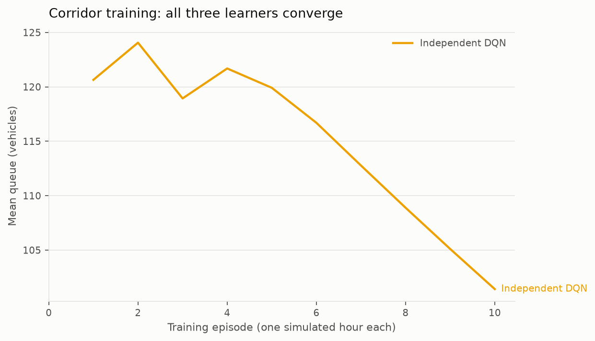
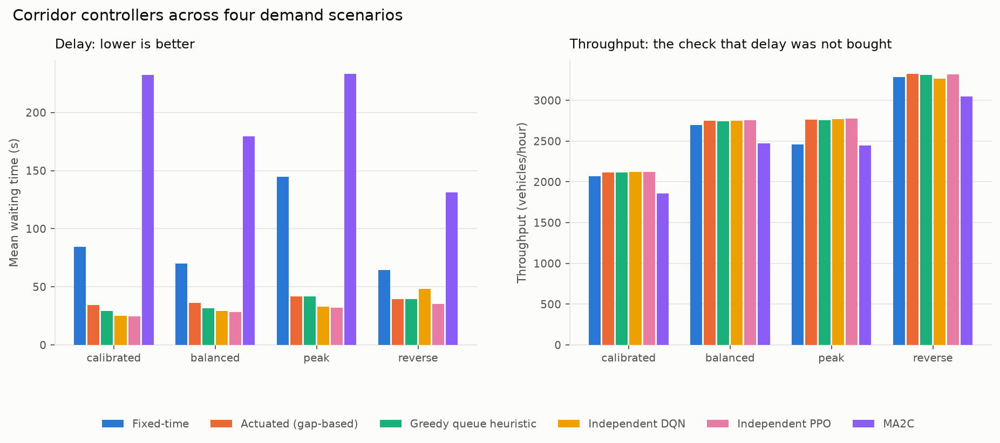
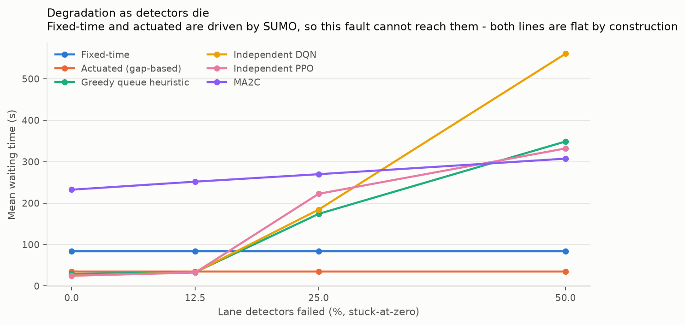
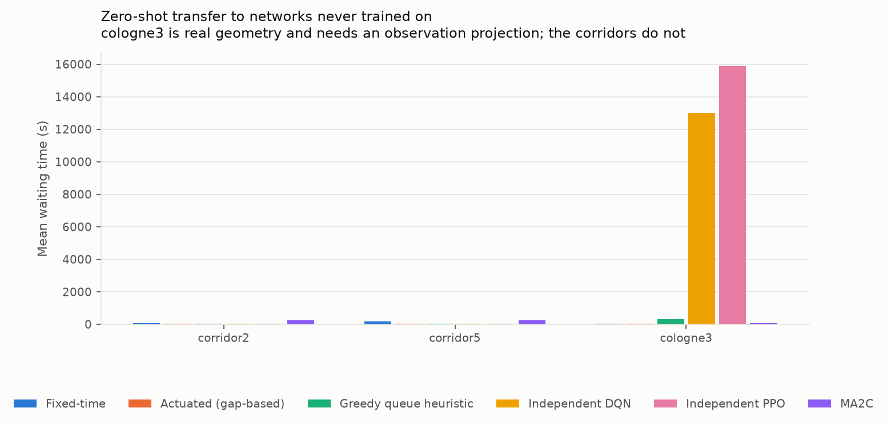

# Adaptive Signal Control on a Multi-Intersection Corridor

A deep-reinforcement-learning study of coordinated traffic signal control along
a three-junction arterial, with fixed-time and actuated baselines, three
multi-agent learners, and a robustness study covering detector failure, demand
shift and zero-shot transfer to an unseen real-world topology.

**This document is additive.** It does not modify, restate or supersede
`REPORT.md`, the finished single-intersection study — that work, its numbers and
its addenda A–E are untouched, and `tests/test_corridor_isolation.py` hashes its
sources to keep them that way. Where this study and that one can be compared,
the comparison is drawn here.

---

> ## Read this before any number below
>
> **One training seed. No significance testing was performed. Every margin in
> this report is a point estimate that a future multi-seed run could revise.**
>
> The single-intersection study measured how much a result moves when only the
> training seed changes: between 0.18 s and 3.03 s of mean waiting time
> depending on the scenario (`REPORT.md`, Addendum B). Differences smaller than
> that are not distinguishable from initialisation noise, and nothing in this
> document should be read as though they were.
>
> This is a deliberate scope decision, not an oversight. The compute budget was
> measured before committing to it: three algorithms at three seeds would be
> roughly 35–45 hours on this machine against 13–17 for one, and one seed across
> three algorithms was judged more informative than three seeds of one.
> `CORRIDOR_PLAN.md` §6 records the reasoning.
>
> Rankings that hold across several scenarios are the trustworthy part of what
> follows. Individual margins are not.

---

## 1. What the brief asked for, and where this lands

| Requirement | Where it is met |
|---|---|
| Microscopic simulation (SUMO) | §2.1 — a generated 3-junction arterial |
| DQN with queue state and delay reward | §2.3, §4 — independent DQN |
| Policy-gradient method (PPO/A2C) | §2.3, §4 — independent PPO, and MA2C's actor-critic |
| Multi-agent RL (MA2C) for coordination | §2.3, §4 — written from scratch, §7 for the deviation |
| **Fixed-time baseline** | §2.3 — the same 104 s plan the original study used |
| **Actuated baseline** | §2.3 — SUMO's gap-based actuated control |
| Demand from real flow profiles | §2.2 — calibrated from `cologne3` (TAPAS Cologne) |
| Avg waiting time, queue, throughput, delay reduction | §5 |
| Convergence (reward curve) | §5.1 |
| **Robustness: detector failure** | §6.1–6.2 |
| **Robustness: demand shift** | §5.2 — the `reverse` scenario |
| **Robustness: unseen topology** | §6.3 — corridor2, corridor5 and real `cologne3` |

The brief is explicit that clean-conditions delay reduction is not the point —
"DQN/PPO-on-SUMO is heavily published already" — and that robustness is what
makes the topic worth doing. §6 is therefore the centre of this report, not an
appendix to §5.

---

## 2. What was built

### 2.1 The corridor

A linear west–east arterial with three signalised junctions, each also served by
a north and a south side street:

```
        N1          N2          N3
        |           |           |
  W ——[J1]——400m——[J2]——400m——[J3]—— E
        |           |           |
        S1          S2          S3
```

- **400 m between signals.** Long enough to hold a queue without spilling back
  into the upstream junction. Spillback would suppress demand outside the
  simulation and flatter every controller equally — the measurement failure the
  original study guards against with its insertion-backlog metric, which is
  reported here too.
- **250 m outer arms**, the length the single-intersection network uses.
- **2 lanes per approach**: lane 0 straight + right, lane 1 a protected left.
- **Four phases per junction**, mutually exclusive, so every phase is
  collision-free and there are no permissive give-way lefts.

The geometry is *tiled from the existing single-intersection network* rather
than drawn afresh, and the result is checkable: each junction's compiled phase
strings come out identical to the validated single-intersection plan —
`GGrrrrGGrrrr`, `rrGrrrrrGrrr`, `rrrGGrrrrGGr`, `rrrrrGrrrrrG`, on a 104 s
cycle. That identity is not decoration. It is what makes a junction here present
the same action space and movement structure the original agents trained on, and
therefore what makes transfer between the two studies meaningful.

**Three junctions, and why not more.** Three is the smallest corridor in which
MA2C is not degenerate: J2 has two signalised neighbours while J1 and J3 have
one, so the architecture's asymmetric neighbour sharing is actually exercised.
With two junctions every agent is an edge agent and "neighbour sharing" reduces
to "the other one".

### 2.2 The demand, and why not PeMS

**PeMS does not fit this problem, and the report does not pretend otherwise.**
It is *freeway* loop-detector data — mainline and ramp volumes at 30 s/5 min
aggregation — with no intersections, no turning movements and no urban arterial
geometry. Calibrating a signalised corridor from freeway mainline counts would
be measuring the wrong quantity on the wrong facility type. The brief names PeMS
as an example rather than a requirement, so an urban source is substituted and
the substitution is stated.

Demand is instead calibrated from **`cologne3`**, the RESCO benchmark corridor
(Ault & Sharon, NeurIPS 2021 Datasets & Benchmarks) derived from the TAPAS
Cologne mobility model and bundled with `sumo-rl`. Measured from its route file,
reproducible with `python corridor/generate_corridor_routes.py --provenance`:

| Quantity | Value |
|---|---|
| Busiest hour (06:31–07:59, real morning peak) | **2,856 veh/h** across three junctions |
| Dominant entry #1 | 550 veh/h (19.3% of demand) |
| Dominant entry #2 | 454 veh/h (15.9%) |
| Distinct entry edges | 33; the top 10 carry 85% |

The two dominant entries are the arterial ends and the long tail is side
streets — a heavy arterial fed by many light side roads. Rounded to 500 veh/h
per arterial end and 200 per side stub, that gives 2,200 veh/h, deliberately a
little under the real 2,856, with the arterial kerb lane at v/c ≈ 0.73 against
the 550 veh/h capacity the original study derived: loaded enough to separate
controllers, below the regime where spillback invalidates the measurement.

| Scenario | Arterial (each end) | Side (each of 6) | Total | Role |
|---|---|---|---|---|
| `calibrated` | 500 veh/h | 200 veh/h | 2,200 | **Training scenario** |
| `balanced` | 350 | 350 | 2,800 | Symmetric — what fixed-time is designed for |
| `peak` | 650 | 260 | 2,860 | `calibrated` × 1.3 |
| `reverse` | 200 | 500 | 3,400 | **Demand shift**: side streets dominate |

**Calibration, not replay**, for three reasons: the counts are aggregates rather
than vehicle-by-vehicle departures, so replay would invent the within-interval
arrival process anyway; a single replay is one sample with no variance estimate,
discarding the multi-seed discipline the whole project rests on; and the
demand-shift scenarios are the base profile *moved*, which a fixed recording
cannot provide.

**What is assumed rather than measured:** the 60/20/20 straight/left/right split
is inherited unchanged from the single-intersection study. `cologne3` gives
volumes, not turning fractions for our geometry. Arrivals at the corridor
boundary are Poisson, which is defensible at an entry point; mid-corridor
arrivals are platooned by the upstream signal, but that platooning is produced
by the simulation itself rather than by the generator, so the approximation is
confined to the boundary.

### 2.3 The controllers

| Controller | What it does | Who drives it |
|---|---|---|
| **Fixed-time** | The 104 s cycle, unchanged from the original study | SUMO |
| **Actuated** | Gap-based: green extends while vehicles keep arriving within `max-gap` 3.0 s, bounded by min 10 s / max 60 s | SUMO |
| **Greedy queue** | Serves whichever phase has the longest queue, per junction, every 5 s | us |
| **Independent DQN** | One policy per junction, local observation only | us |
| **Independent PPO** | Same, on-policy | us |
| **MA2C** | Actor-critic per junction with neighbour observation sharing, neighbour policy sharing and spatially discounted reward | us |

**The greedy heuristic is not an actuated controller and is not labelled as
one.** It picks a phase from global queue knowledge every 5 s; an actuated
controller runs a fixed phase *sequence* and decides only when to terminate the
current green, from detector gap-out. Relabelling one as the other would be the
kind of quiet overstatement this project has twice had to remove. The actuated
baseline is SUMO's own implementation, so it is standard and independently
specified rather than ours.

**A consequence to note before reading §6:** SUMO drives both fixed-time and
actuated itself, so their `act()` is never consulted and they cannot be
perturbed at the observation level at all. Their bounds come from the program's
own `minDur`/`maxDur`, pinned to the project's MIN_GREEN and MAX_GREEN, so every
controller here still pays an identical amber and minimum-green cost. §6.2
returns to what that structural immunity does and does not mean.

The maximum-green and anti-starvation wrapper from the single-intersection study
(`REPORT.md`, Addendum E) is available for corridor controllers and is covered by
tests, but **no `+safe` sweep was run here and none is reported**. Whether the
corridor's learned policies violate the starvation bound the way the
single-intersection ones did is an open question this study does not answer.

---

## 3. How the comparison is kept fair

The same four guarantees the single-intersection study rests on:

- **One code path.** All six controllers run through
  `corridor/env.py:run_corridor_episode`. They are not merely measured with the
  same metrics — they are measured by the same code.
- **The same vehicles.** A `(scenario, seed)` pair names a file listing exactly
  which car arrives when and where it is going. Every controller drives the
  identical hour.
- **The same safety constraints.** 4 s amber and 10 s minimum green for
  everything, the actuated plan included, whose bounds are pinned to the
  project's constants rather than to SUMO's defaults. Differing amber times
  would be the easiest way to rig a comparison.
- **Unseen demand.** Training used seeds 0–9; every number here is measured on
  seeds 100–104.

And one the corridor adds:

- **The same dead detectors.** In §6.1 the failed detector set is drawn from an
  RNG seeded by `(scenario, seed, rate, mode)` and by nothing identifying the
  controller, so every controller faces the identical fault on the identical
  hour. Without that, "degradation" would partly measure a difference in the
  perturbation.

**Throughput is never reported without waiting time beside it.** A controller
can make delay look excellent by refusing to admit vehicles; on a corridor it
can also do so by starving the link that feeds its neighbour. Every table below
carries throughput, and the insertion backlog is recorded per episode so that
suppressed demand is visible rather than silently improving a number.

---

## 4. Did the learners converge?

<!-- BEGIN GENERATED: convergence -->
<!-- END GENERATED: convergence -->



---

## 5. Results under clean conditions

### 5.1 Every controller, every scenario

<!-- BEGIN GENERATED: headline -->
<!-- END GENERATED: headline -->



### 5.2 Delay reduction against fixed-time

The brief's headline metric. Negative is an improvement.

<!-- BEGIN GENERATED: reduction -->
<!-- END GENERATED: reduction -->

`reverse` is the demand-shift test: the side streets carry more than the
arterial the agents trained on favouring. It is the corridor analogue of the
`ew_heavy` test that exposed a 20.8% directional penalty in the
single-intersection study.

### 5.3 Throughput, so the reductions above can be read honestly

<!-- BEGIN GENERATED: throughput -->
<!-- END GENERATED: throughput -->

---

## 6. Robustness — the part the brief calls the point

### 6.1 Detector failure

A wrapper corrupts the observation before the controller sees it. **The
simulation is untouched**: the vehicles are still queueing and still crossing,
and every metric is still measured from the real simulation. The controller
simply cannot see some of them. That separation is what makes this a *sensing*
failure rather than a change in demand — deleting vehicles would change the
information and the problem at once, and the resulting number would answer
neither question.

Only the sixteen detector-derived values are corrupted (8 lane densities, 8 lane
queues). The phase one-hot and the minimum-green flag are the signal's own
state, not a measurement, so corrupting them would model a different fault. A
failed detector takes out both the density and the queue for its lane, because
those come from one physical sensor.

Two modes, reported separately because a controller can be robust to one and not
the other:

- **Stuck-at-zero** — the lane reports an empty road. The dangerous one: an
  approach that looks empty may never be served, so the fault actively misleads
  rather than merely withholding.
- **Freeze** — the lane holds its last good reading. Milder, and closer to a
  communications dropout than to a dead loop.

<!-- BEGIN GENERATED: detector -->
<!-- END GENERATED: detector -->



### 6.2 The margin over fixed-time, which is the actual question

**Fixed-time reads no detectors, so its degradation is zero by construction.**
That is not a virtue and must not be read as one — it cannot respond to demand
at all, which is why it is slow in the first place. It is the reference line,
the same way the inert `fixed-time-tuned+safe` row is arithmetic rather than
evidence in `REPORT.md`.

The question worth answering is therefore not how far an adaptive controller
falls, but whether it is still ahead of the clock when half its detectors are
dead. Negative means still faster than fixed-time.

<!-- BEGIN GENERATED: margin -->
<!-- END GENERATED: margin -->

### 6.3 Zero-shot transfer to unseen topologies

Two kinds, which answer different questions and are not pooled.

**Clean transfer — `corridor2` and `corridor5`.** Built by the same generator,
so every junction has the same 4 phases and 8 lanes the policies trained on.
The observation projection is exactly a no-op here, so for the independent
learners the measured change is topology and nothing else: a different number
of junctions, a different neighbour structure, different interior-versus-edge
roles. This is the unconfounded measurement.

> **With one exception, which belongs to MA2C alone.** The independent learners
> share parameters, so one network drives a corridor of any length without
> adaptation. MA2C does not share parameters — it has a network *per junction* —
> so on `corridor5` its three trained agents are reused cyclically to cover five
> junctions. That is an approximation, and it means MA2C's `corridor5` number is
> not clean in the way the others are. Its `corridor2` number is, since two of
> its three agents simply go unused. This is the price of the specialisation
> that makes MA2C interesting, and it is the mirror image of the trade-off
> recorded in limitation 2.

**Real-topology transfer — `cologne3`.** Much stronger evidence, because we did
not draw it. But its junctions are structurally incompatible with ours:

| Junction | Green phases | Controlled lanes | Observation |
|---|---|---|---|
| `360082` | 3 | 5 | 14 values |
| `360086` | 4 | 6 | 17 values |
| `GS_cluster_…` | 4 | 8 | 21 values |

Our policies expect 4 phases and 8 lanes — 21 values. **Only one of the three
junctions fits.** So a projection is unavoidable: observations are zero-padded
or truncated to 21 values and actions are clamped into the phases a junction
actually has. Both are defined explicitly in `corridor/transfer.py` and tested
on hand-computable cases, and the projection is exactly a no-op on a corridor we
generated, which is what keeps the clean transfers clean.

> **A `cologne3` number mixes the difficulty of an unseen topology with the cost
> of the adaptation itself, and those two cannot be separated from that number
> alone.** The clean transfers exist to give an unconfounded reading beside it.

Two further caveats specific to this target. MA2C's agents are matched
positionally onto sorted junction ids, which is the true west-to-east order on a
corridor we built but an assumption on `cologne3`. And the actuated variant of
`cologne3` has detectors on 16 of its 19 controlled lanes — three lanes at the
cluster junction have none — so its actuation is partial there.

**The baselines need no adaptation at all.** SUMO drives fixed-time and actuated
from the target's own program, and the greedy heuristic reads whatever signal it
finds. Only the learned controllers are projected. That asymmetry is itself a
finding: it is a real deployment cost of a learned policy that a conventional
controller does not pay.

<!-- BEGIN GENERATED: transfer -->
<!-- END GENERATED: transfer -->



---

## 7. Limitations

Stated as plainly as the single-intersection study states its own.

1. **One training seed, and no significance testing.** Repeated from the top
   because it conditions everything: every margin here is a point estimate.
   Addendum B of `REPORT.md` measured seed-to-seed spread at 0.18–3.03 s in the
   single-intersection case, and there is no reason to expect the corridor to be
   tighter. Rankings that hold across several scenarios are the trustworthy
   part; individual differences of a second or two are not.
2. **The independent learners share parameters.** `CORRIDOR_PLAN.md` §3 proposed
   one network per junction. What is implemented is one network trained on all
   three junctions' experience, with each junction still acting independently on
   its own local observation. The reason is that topology transfer is otherwise
   undefined — there is no principled answer to which of three policies drives
   junction 4 of a five-junction corridor. The cost is real: the three junctions
   occupy genuinely different roles and a shared network cannot specialise to
   them. MA2C, whose agents do not share parameters, is the contrast.
3. **MA2C has no LSTM.** The published algorithm (Chu et al., IEEE T-ITS 2020)
   puts a recurrent layer in each agent; v1 here does not, and
   `CORRIDOR_PLAN.md` §10 records the decision. If MA2C underperforms the
   simpler independent learners, the missing LSTM is a live candidate
   explanation and this report does not conclude that MA2C does not work.
4. **The demand calibration is partial.** `cologne3` supplies volumes and the
   arterial/side split. Turning fractions are inherited from the
   single-intersection study, not measured.
5. **One corridor geometry.** Uniform 400 m spacing, identical junctions,
   symmetric side streets. Real arterials are none of those things, which is
   part of why `cologne3` is included despite needing a projection.
6. **No signal coordination baseline.** A green-wave offset plan is the
   conventional engineering answer to a corridor and would be the natural
   further baseline. It is not implemented here.
7. **Detector failure is modelled at the observation, not the sensor.** Real
   failures have correlated causes — a cabinet loses power and takes an approach
   with it — whereas lanes here fail independently.
8. **The demand-shift study covers two of the four shifts planned.**
   `CORRIDOR_PLAN.md` §5b listed volume scaling, directional reversal, a
   temporal within-hour peak, and a mid-episode incident. Volume scaling
   (`peak`) and directional reversal (`reverse`) are implemented and reported;
   the temporal and incident shifts were dropped under the plan's own compute
   fallback and are not claimed. The incident case is the one most worth adding
   next, because it is the most realistic and the only one that tests recovery
   rather than a steady state.

---

## 8. Relationship to the single-intersection study

Nothing in `REPORT.md` is restated, revised or superseded by this document. The
two studies share a reward function, a decision interval, amber and minimum
green, an observation layout and an evaluation discipline — the corridor imports
those constants rather than copying them, so they cannot drift apart, and
`tests/test_corridor_isolation.py` fails if any single-intersection source or
`REPORT.md` itself is modified.

What differs is the problem: three coupled junctions where one junction's
decisions become its neighbour's arrivals, two baselines instead of one, and a
robustness study that the original explicitly listed as missing.

---

## 9. Reproducing this

```bash
python corridor/build_corridor.py --all              # corridor 2, 3 and 5
python corridor/generate_corridor_routes.py          # 60 route files
python corridor/train_independent.py --algo dqn      # ~3-5 h
python corridor/train_independent.py --algo ppo      # ~3-5 h
python corridor/train_ma2c.py                        # ~3-5 h
python corridor/evaluate_corridor.py                 # the clean sweep
python corridor/robustness.py --all                  # failure + transfer
python corridor/make_corridor_tables.py --write      # this report's tables
python corridor/make_corridor_plots.py               # its figures
python -m pytest                                     # the whole suite
```

Training seeds are fixed. Traffic simulation is stochastic, so every reported
cell is the mean of **5 independent hours** with the standard deviation beside
it — but that is variation between *hours of traffic*, not between trained
policies, which is the quantity a single training seed leaves unmeasured.
