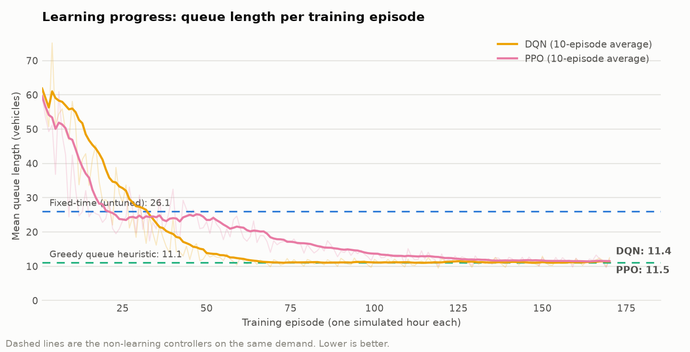
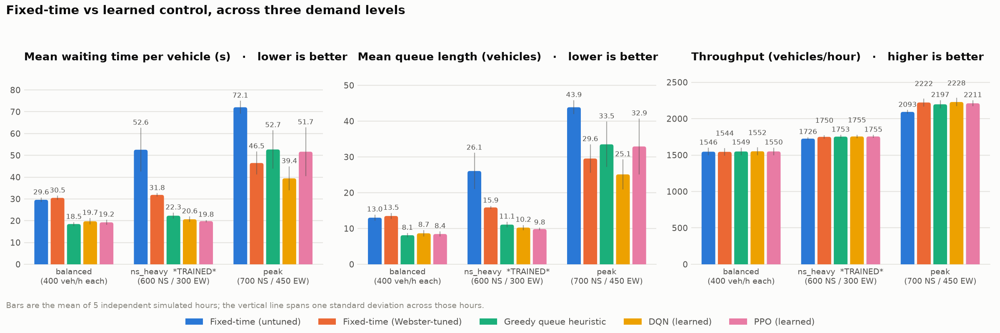
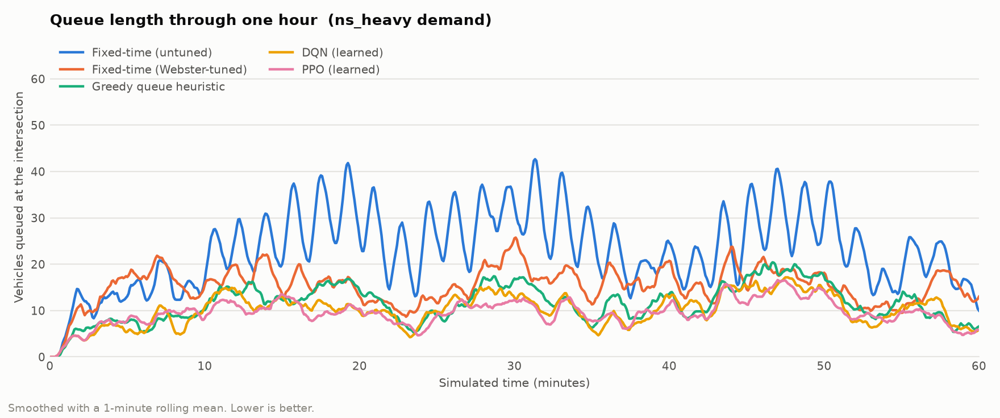
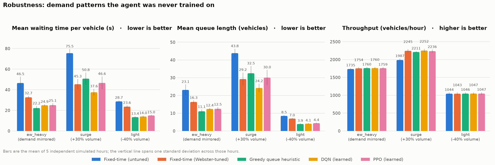

# Adaptive Traffic Signal Control Using Deep Reinforcement Learning

**A reinforcement-learning agent controlling one four-way intersection in the
SUMO traffic simulator, measured against conventional fixed-time control.**

---

## 1. Summary

A deep reinforcement-learning agent (DQN) was trained to choose which traffic
signal phase to display at a four-way intersection, using nothing but the
queues it can observe. Across six demand scenarios it reduced mean waiting time
per vehicle by **33% to 61%** compared with a standard fixed-time signal, while
moving slightly *more* vehicles through the junction.

That is the headline, but three findings matter more for judging it honestly:

1. **Most of the benefit comes from being adaptive at all, not from deep
   learning.** A five-line heuristic - "serve whichever direction has the
   longest queue" - captures most of the same gain, and actually beats the
   learned agent on three of the six scenarios.

2. **The learned agent's distinctive advantage appears under saturation.** When
   the intersection is loaded to capacity, the greedy heuristic degrades badly
   while the DQN does not: on the `peak` scenario the DQN waits 39.4 s against
   the heuristic's 52.7 s, a 25% improvement over it.

3. **The fixed-time baseline's numbers flatter it.** Under the heaviest demand
   it could not physically admit ~227 vehicles per hour into the network. Those
   vehicles contribute nothing to its average waiting time, so its true
   performance is worse than the tables below show. See §5.2.

A second agent (PPO) trained independently reached the same performance as DQN
on light and moderate demand, which is reassuring: two different algorithm
families converging on the same answer suggests the result is a property of the
traffic problem rather than of one algorithm.

---

## 2. What was built

### 2.1 The intersection

A single four-way signalised intersection, built from scratch rather than
downloaded, so every detail is known and reproducible.

- Four approaches (north, south, east, west), each a 250 m arm. The arms are
  deliberately long: if a queue overflows the end of an arm, SUMO stops
  inserting vehicles and the congestion vanishes from the measurements instead
  of being counted.
- Two lanes per approach. The kerb lane carries straight-ahead and
  right-turning traffic; the median lane is a protected left-turn lane.
- 50 km/h speed limit, standard car-following behaviour.

### 2.2 The signal

Four phases, each internally conflict-free:

| Phase | Movements served |
|---|---|
| 0 | North-south straight ahead and right turns |
| 1 | North-south protected left turns |
| 2 | East-west straight ahead and right turns |
| 3 | East-west protected left turns |

Choosing which of these four to display is the entire decision problem. Every
controller in this report solves the same problem with the same options and the
same constraints: a 4-second amber on every phase change, and a 10-second
minimum green before a phase may be abandoned.

### 2.3 The traffic

Vehicles arrive as a **Poisson process** on each approach - the gap between
successive vehicles is drawn from an exponential distribution. This is the
standard model for arrivals at an isolated intersection, and it is central to
the experiment: it produces realistic clumping (four cars nose to tail, then
twenty empty seconds). A fixed-time signal cannot respond to that clumping; an
adaptive one can. **The randomness is the opportunity being measured.**

Turning proportions are 60% straight, 20% left, 20% right on every approach, so
the only thing differing between scenarios is volume.

| Scenario | N/S per approach | E/W per approach | Role |
|---|---|---|---|
| `balanced` | 400 veh/h | 400 veh/h | Evaluation |
| `ns_heavy` | 600 veh/h | 300 veh/h | **Training** + evaluation |
| `peak` | 700 veh/h | 450 veh/h | Evaluation |
| `ew_heavy` | 300 veh/h | 600 veh/h | Robustness (unseen) |
| `surge` | 780 veh/h | 390 veh/h | Robustness (unseen) |
| `light` | 360 veh/h | 180 veh/h | Robustness (unseen) |

The volumes are not arbitrary. One lane discharges about 1800 veh/h on green.
Under the untuned fixed-time plan the kerb lane gets 32 s of green in a 104 s
cycle, giving it a capacity near 550 veh/h. `balanced` loads it to about 58% of
that, `ns_heavy` to 87%, and `peak` to just over 100%. The scenarios therefore
span free-flowing, busy, and oversaturated conditions - which matters, because
controllers can only be told apart when the junction is under load.

### 2.4 The controllers

**Fixed-time (untuned).** Equal green for north-south and east-west: 32 s per
through phase, 12 s per left phase, 4 s amber, 104 s cycle. It never looks at
traffic. This is the baseline the brief asks for and represents a signal nobody
has retimed for current demand.

**Fixed-time (Webster-tuned).** The same idea with the green split computed
from the demand. This is the honest bar to clear - beating a signal that gives
a busy arterial and an empty side street identical green is a weak result.

Note this baseline is **told the demand in advance**, information the RL agent
never receives. That advantage is deliberate: the baseline should be as strong
as it reasonably can be.

**Greedy queue heuristic.** Always switch to whichever phase currently has the
most vehicles waiting. Five lines, no learning. Included because "RL beats a
signal that ignores traffic" is not an interesting claim on its own.

**DQN and PPO.** The learned controllers (§3).

---

## 3. How the agent learns

### 3.1 What it sees

At each decision point the agent receives 21 numbers: which phase is currently
green (four on/off values), whether the minimum green has elapsed, and for each
of the eight incoming lanes how full it is and how many vehicles on it are
stopped.

Note what is *absent*: no arrival rates, no time of day, no knowledge of which
scenario it is in, no model of traffic. It must infer everything from queues it
can see.

### 3.2 What it is scored on

Reward at each step is **minus the average number of stopped vehicles per
incoming lane**. It is negative because the learning algorithms maximise
reward and we want delay minimised.

Summed over an hour this equals minus the total vehicle-seconds spent queueing,
which is the same quantity as the total waiting time experienced by all
drivers. So the episode score is not a proxy for the reported metric - it *is*
the reported metric, which is what makes the training curve readable as a
performance curve.

> **A design decision worth recording.** `sumo-rl`'s default reward
> (`diff-waiting-time`, the *change* in waiting time between steps) was tried
> first and rejected. Its per-step values telescope: summed over an episode they
> collapse to (waiting at the start) − (waiting at the end), which measured
> about −2 for **both** a good and a bad controller. It can still train a
> policy, because discounting favours clearing queues early, but its episode
> return carries almost no information about how the hour went - which would
> have made the required "show that learning happened" plot unreadable.

### 3.3 How it is trained

One episode is one simulated hour = 720 decisions. Training ran for 170
episodes (about 46 minutes on a laptop CPU for DQN, 26 for PPO).

Training rotates through **ten independently generated hours** of `ns_heavy`
demand rather than replaying one. With a single fixed hour, the cheapest way to
score well is to memorise the arrival sequence - "at 14 minutes 35 seconds,
switch to east-west" - which is a recording, not a controller.

| Setting | Value | Why |
|---|---|---|
| Decision interval | 5 s | Fast enough to react to an arriving platoon; slow enough that a decision has a visible effect |
| Discount factor | 0.95 | A ~100 s horizon, about one signal cycle |
| Minimum green | 10 s | Without it the agent flickers between phases, wasting the junction on amber |
| Amber | 4 s | Identical to the fixed-time plan, so both pay the same cost to switch |
| Network | 2 layers, 64 units | The observation is 21 numbers; more capacity would only overfit |

Both agents come from `stable-baselines3` rather than being hand-written. A
hand-rolled DQN is where subtle bugs hide, and none of this project's questions
concern the algorithm's internals.

---

## 4. Results

### 4.1 Did the agent actually learn?



Yes, and it then stopped improving - which is what we need to see. Starting
from random behaviour (a queue of about 60 vehicles), DQN overtakes the
fixed-time signal at roughly episode 30 and flattens out from about episode 70
at **11.4 vehicles**. PPO follows the same path more slowly and plateaus around
episode 130 at **11.5**.

The faint lines are individual episodes. That scatter is real - each episode is
a different random hour - and it is left visible rather than smoothed away,
because hiding it would overstate how cleanly learning proceeded.

PPO's slower approach is the expected cost of being *on-policy*: it discards
its experience after each update, whereas DQN replays a stored buffer many
times. Mid-run PPO appeared to have stalled near 24 vehicles; it had not, and
that is a reminder not to declare a curve plateaued while it is still
descending.

### 4.2 The headline comparison



Mean waiting time per vehicle, averaged over 5 independent simulated hours
(± one standard deviation):

<!-- BEGIN GENERATED: main-wait -->
| Controller | `balanced` | `ns_heavy` *(trained)* | `peak` |
|---|---|---|---|
| Fixed-time (untuned) | 29.6 ± 0.8 | 52.6 ± 9.8 | 72.1 ± 2.7 |
| Fixed-time (Webster-tuned) | 30.5 ± 0.8 | 31.8 ± 0.5 | 46.5 ± 5.1 |
| Greedy queue heuristic | **18.5 ± 0.7** | 22.3 ± 1.2 | 52.7 ± 8.6 |
| **DQN (learned)** | 19.7 ± 1.3 | 20.6 ± 1.1 | **39.4 ± 5.3** |
| PPO (learned) | 19.2 ± 0.9 | **19.8 ± 0.3** | 51.7 ± 10.9 |
<!-- END GENERATED: main-wait -->

Three things to read out of this.

**The waiting-time reduction is not bought by turning vehicles away.**
Throughput rises slightly under every adaptive controller (on `peak`: 2093
veh/h for fixed-time versus 2228 for DQN). This check matters, because a
controller could trivially improve average waiting time by admitting fewer
cars.

**Retiming the fixed-time plan closes much of the gap - except when it can't.**
Webster tuning cuts waiting time by 30-40% on the four lopsided scenarios.
On `balanced` it buys nothing - in fact it is marginally worse (+3.0%, or
0.9 s) - which is exactly right: when demand really is symmetric a symmetric
plan is already the correct plan, and retiming can only lose a little to
rounding.

**The DQN is far more consistent than the fixed-time plan.** On `ns_heavy` its
standard deviation across five random hours is ±1.1 s against fixed-time's
±9.8 s. A fixed plan is at the mercy of how the traffic happens to clump; an
adaptive one absorbs it.

### 4.3 What an hour actually looks like



This is the mechanism behind the averages. The fixed-time signal saws violently
up and down - each cycle admits a fixed slug of traffic regardless of what is
waiting - peaking above 40 queued vehicles. The adaptive controllers hold the
queue near a steady 10-15 for the whole hour.

The tuned fixed-time plan (orange) is visibly smoother than the untuned one,
because its shorter cycle serves each direction more often; but it still cannot
respond to an individual platoon.

### 4.4 Robustness: demand the agent never trained on



The agent was trained **only** on `ns_heavy`. These three scenarios were never
seen during training:

<!-- BEGIN GENERATED: robustness-wait -->
| Controller | `ew_heavy` (mirrored) | `surge` (+30%) | `light` (−40%) |
|---|---|---|---|
| Fixed-time (untuned) | 46.5 ± 5.9 | 75.5 ± 3.8 | 28.7 ± 0.8 |
| Fixed-time (Webster-tuned) | 32.7 ± 1.1 | 45.3 ± 4.8 | 23.6 ± 0.9 |
| Greedy queue heuristic | **22.2 ± 1.8** | 50.8 ± 5.6 | **13.4 ± 0.6** |
| **DQN (learned)** | 24.9 ± 0.6 | **37.6 ± 3.0** | 14.0 ± 0.6 |
| PPO (learned) | 25.1 ± 1.5 | 46.6 ± 6.0 | 15.0 ± 0.3 |
<!-- END GENERATED: robustness-wait -->

**The agent degrades gracefully, but it does degrade.** The clearest evidence
is `ew_heavy`, which is `ns_heavy` mirrored - the same total demand, with the
busy and quiet roads swapped. The DQN goes from 20.6 s on the demand it trained
on to 24.9 s on the mirrored version, about **21% worse**. The greedy
heuristic, which has no learned bias, is unaffected (22.3 → 22.2 s).

That gap is the honest cost of learning a policy from one demand pattern: the
agent has absorbed a directional preference for north-south that does not
transfer. It still beats the untuned fixed-time plan by 46% on the mirrored
demand, so the failure mode is a loss of some advantage, not a collapse.

**Under overload the learned agent pulls decisively ahead.** On `surge` the
DQN's 37.6 s beats the greedy heuristic's 50.8 s by 26%, and beats even the
demand-tuned fixed plan. This is the clearest case for learning over a
heuristic: when the junction is beyond capacity, always serving the longest
queue is a myopic strategy, because it keeps switching to whichever direction
has most recently built up rather than committing long enough to actually clear
anything.

---

## 5. Reading these numbers honestly

### 5.1 The heuristic is the real competition

The comparison that flatters deep RL is against untuned fixed-time control.
The comparison that informs is against the greedy heuristic, and there the
result is mixed:

<!-- BEGIN GENERATED: heuristic-vs-dqn -->
| Scenario | Greedy | DQN | Winner |
|---|---|---|---|
| `balanced` | 18.5 | 19.7 | Greedy (6% better) |
| `ns_heavy` | 22.3 | 20.6 | DQN (7% better) |
| `peak` | 52.7 | 39.4 | **DQN (25% better)** |
| `ew_heavy` | 22.2 | 24.9 | Greedy (11% better) |
| `surge` | 50.8 | 37.6 | **DQN (26% better)** |
| `light` | 13.4 | 14.0 | Greedy (4% better) |
<!-- END GENERATED: heuristic-vs-dqn -->

The pattern is consistent and interpretable: **when the intersection is below
capacity the two are within a few percent of each other, and when it is at or
beyond capacity the DQN wins by around 25%.** The honest summary is that most
of the value here comes from responding to traffic at all - which a trivial
heuristic achieves - and that the learned policy earns its keep specifically in
the oversaturated regime.

### 5.2 The fixed-time baseline is flattered by a measurement artefact

At the end of every episode the harness asks SUMO how many vehicles are still
queued waiting to be placed on the network, because the approach they need is
full. Vehicles that never enter cannot accrue waiting time, so they silently
improve the average of whichever controller was too congested to admit them.

Read the figure for what it is: a snapshot of the insertion backlog at the
moment the hour ends, not a running count over the hour. Since demand stops
when the episode does, a vehicle still in that queue is one that never got in
at all, which is the quantity the argument below needs.

<!-- BEGIN GENERATED: insertion-backlog -->
| Scenario | Controller | Still awaiting insertion at the hour's end (mean) |
|---|---|---|
| `surge` | Fixed-time (untuned) | **227** |
| `peak` | Fixed-time (untuned) | **95** |
| `surge` | Greedy queue heuristic | 16 |
| `ns_heavy` | Fixed-time (untuned) | 5 |
| `peak` | Greedy queue heuristic | 4 |
| `ew_heavy` | Fixed-time (untuned) | 4 |
| all others | Fixed-time (untuned), Fixed-time (Webster-tuned), Greedy queue heuristic, DQN (learned), PPO (learned) | 0 |
<!-- END GENERATED: insertion-backlog -->

Under `surge` the untuned fixed-time plan failed to admit roughly 10% of the
demanded traffic, and those are precisely the worst-delayed vehicles. **Its
true waiting time is therefore worse than the 75.5 s reported, and the DQN's
50% improvement on that scenario is an underestimate.** The learned
controllers dropped no vehicles at all.

This is reported rather than quietly corrected because there is no defensible
way to impute a waiting time for a vehicle that never existed in the
simulation. It is flagged here so the tables are not over-read.

### 5.3 PPO is not simply "worse than DQN"

PPO matches DQN on `balanced`, `ns_heavy` and `light`, and is clearly behind on
`peak` (51.7 vs 39.4) and `surge` (46.6 vs 37.6) - the two saturated scenarios -
where it also shows much larger run-to-run variance (±10.9 s). Both were given
an identical 170-episode budget. Given that PPO's training curve was still
descending later than DQN's, the most likely explanation is that 170 episodes
is simply less adequate for an on-policy method, not that PPO is unsuited to
the problem. A longer PPO run is the obvious follow-up and was not attempted.

---

## 6. Limitations

Listed roughly in order of how much they should temper the headline number.

**The simulation is not traffic.** SUMO models car-following and lane-changing
well, but not drivers blocking the box, cyclists, pedestrians, buses stopping
in-lane, or a van double-parked across the kerb lane - exactly the disturbances
an adaptive controller might handle badly. This is evidence the approach is
worth testing further, **not** evidence it would work on a street.

**Demand is synthetic.** Poisson arrivals with a fixed mean and constant
turning rates. Real demand has a peak that builds and fades, and platoons
released by upstream signals - which violates the independence assumption
Poisson arrivals rest on.

**One intersection, in isolation.** The agent cannot cause the failure mode
that matters most in a real network: discharging a platoon into a downstream
junction that is already full. A single-agent result says nothing about whether
this policy is a good network citizen.

**The agent is specialised.** It is a policy for *this* junction under *roughly
this* demand. §4.4 quantifies what that costs when demand shifts.

**The baselines are not modern adaptive control.** SCOOT, SCATS and
vehicle-actuated control are considerably better than fixed-time and are not in
this comparison. The greedy heuristic is a rough stand-in. The right reading is
"adaptive control helps a lot here, and a learned policy is at least as good as
a simple responsive one" - not "deep RL beats the state of the art".

**Nothing here is safety-validated.** No maximum green, no pedestrian phases,
no guarantee an approach is never starved. The 10 s minimum green and 4 s amber
are the only constraints implemented.

**Statistical caveats.** Five runs per controller per scenario is enough to
establish the large differences reported and not enough to resolve small ones;
treat any gap of a second or two as noise. No significance test was run.
Training used a **single seed (42)** - a thorough study would train several
agents and report the spread, because a single run can be lucky.

---

## 7. Future work

In rough order of value added:

1. **Multiple training seeds** - the cheapest way to make the headline number
   trustworthy.
2. **Train on mixed demand** rather than several hours of one pattern; this
   directly targets the `ew_heavy` weakness in §4.4.
3. **A corridor of two or three intersections**, which would expose the
   spillback behaviour a single junction cannot show.
4. **Real demand data**, removing the largest caveat above.
5. **A stronger baseline** - vehicle-actuated control rather than fixed-time.
6. **Safety and fairness constraints** - maximum green, guaranteed pedestrian
   service, starvation checks.
7. **A longer PPO run**, per §5.3.

Deliberately out of scope and not attempted: multi-agent coordination
algorithms (MA2C, MADDPG), transfer to unseen network topologies, and anything
requiring GPU clusters.

---

## 8. Reproducing this

```bash
pip install -r requirements.txt          # SUMO included, no admin rights needed
python networks/build_network.py         # build the intersection
python networks/generate_routes.py       # generate the traffic
python smoke_test.py                     # verify the toolchain
python baseline/run_baseline.py          # fixed-time baselines      (~5 min)
python agent/train_dqn.py                # train the DQN             (~46 min)
python agent/train_ppo.py                # train PPO                 (~26 min)
python eval/evaluate.py                  # compare everything        (~25 min)
python eval/make_plots.py                # figures
python eval/make_tables.py --write       # the tables in this report
```

**Where the numbers come from.** Every results table in this report sits
between a paired `BEGIN GENERATED` / `END GENERATED` HTML comment and is
written into this file by `eval/make_tables.py --write`, straight from
`results/logs/evaluation_summary.csv` and `evaluation_raw.csv`. Re-running the
evaluation and then that command updates the tables in place; nothing in them
is transcribed by hand. Figures quoted in the surrounding prose are read off
those tables, so if a table moves and a sentence does not, the two will
visibly disagree rather than quietly agreeing on a stale number.

**How the comparison is kept fair:** all controllers run through one code path
(`eval/simulation.py:run_episode`), on the identical list of vehicles for a
given scenario and seed, with identical amber and minimum-green constraints.
Training used demand seeds 0-9; every number reported here uses seeds 100-104,
which the agents never saw.

Full per-scenario tables, including time lost and throughput, are in
[`results/logs/results_tables.md`](results/logs/results_tables.md). Raw
per-episode records are in `results/logs/evaluation_raw.csv`.

---

## 9. Appendix: what "waiting time" and the other metrics mean

| Metric | Definition |
|---|---|
| **Mean waiting time** | Average seconds per vehicle spent stopped (below 0.1 m/s). The headline metric: what a driver experiences. |
| **Mean queue length** | Time-averaged count of stopped vehicles across all four approaches. What the *road* experiences - a long queue can block upstream junctions even when individual delay looks acceptable. |
| **Throughput** | Vehicles completing their trip within the hour. Reported alongside waiting time so a controller cannot look good by admitting fewer vehicles. |
| **Time lost** | Seconds lost against driving the same route at free-flow speed. Slightly fairer than raw waiting time, as it also counts slow crawling rather than only full stops. |
| **Awaiting insertion** | Demanded vehicles still queued to enter the network when the hour ended, because the approach was full. A snapshot at t=3600, not a running total. The honesty check of §5.2. Recorded as `vehicles_not_inserted` in the CSVs, or `-1` if SUMO could not be asked. |

Per-vehicle statistics come from SUMO's trip report, generated with
`--tripinfo-output.write-unfinished` so that vehicles still queueing when the
hour ends are **included**. Without that flag the worst-delayed vehicles - the
ones still stuck - would be dropped from the average, and every controller
would look better than it is, congested ones most of all.

---

# Addenda: post-audit follow-up work

Everything above is the original report as written and independently audited.
Nothing in it has been rewritten: the sections below were **added afterwards**,
and where they qualify a conclusion above they say so explicitly rather than
editing it away.

Four follow-up experiments were run, each targeting a weakness the report
itself identified in §6 and §7:

| Addendum | Targets | From |
|---|---|---|
| A. Paired significance tests | "No significance test was run" | §6 |
| B. Multiple training seeds | "Training used a single seed (42)" | §6, §7.1 |
| C. Mixed-demand training | The 21% directional bias on `ew_heavy` | §4.4, §7.2 |
| D. A longer PPO run | Whether PPO's deficit is sample efficiency | §5.3, §7.7 |
| E. Maximum green and starvation bounds | "Nothing here is safety-validated" | §6, §7.6 |

The corridor of multiple intersections (§7.3) was deliberately not attempted.

<!-- BEGIN GENERATED: significance -->
## Addendum A: paired significance tests

Every controller drives the *same* five hours of traffic on a given
scenario, so the comparison is paired and the differences below are
per-seed. `Mean diff` is A - B in seconds of mean waiting time, so a
negative value means A waits less.

Two tests are reported. The **paired t-test** is the primary result:
it uses the magnitude of each difference and so has usable power at
n = 5. The **exact Wilcoxon signed-rank test** is a distribution-free
cross-check that assumes nothing about normality.

> **Read the Wilcoxon column with its ceiling in mind.** With 5 paired
> observations there are only 2^5 = 32 equally likely sign assignments
> under the null, so the smallest two-sided p-value it can return is
> 0.0625. It can never report significance at the 0.05 level here, however
> large the effect. A `0.0625` in that column is the test's floor - it means
> *every* seed favoured the same controller, which is the strongest
> signal the test is capable of producing at this sample size, not a
> null result.

Significance markers: `***` p<0.001, `**` p<0.01, `*` p<0.05,
`n.s.` not significant at 0.05. Metric: `mean_waiting_time_s`.

### DQN vs Greedy queue

| Scenario | Mean diff (s) | \|t\| | p (paired t) | Verdict | p (Wilcoxon) |
|---|---|---|---|---|---|
| `balanced` | +1.27 | 3.93 | 0.0170 | * | 0.0625 |
| `ns_heavy` | -1.65 | 3.55 | 0.0239 | * | 0.0625 |
| `peak` | -13.26 | 7.47 | 0.0017 | ** | 0.0625 |
| `ew_heavy` | +2.72 | 3.00 | 0.0401 | * | 0.1250 |
| `surge` | -13.20 | 7.48 | 0.0017 | ** | 0.0625 |
| `light` | +0.61 | 1.44 | 0.2238 | n.s. | 0.3125 |

### DQN vs Fixed-time (untuned)

| Scenario | Mean diff (s) | \|t\| | p (paired t) | Verdict | p (Wilcoxon) |
|---|---|---|---|---|---|
| `balanced` | -9.87 | 28.88 | 0.0000 | *** | 0.0625 |
| `ns_heavy` | -31.93 | 7.77 | 0.0015 | ** | 0.0625 |
| `peak` | -32.63 | 23.44 | 0.0000 | *** | 0.0625 |
| `ew_heavy` | -21.61 | 8.45 | 0.0011 | ** | 0.0625 |
| `surge` | -37.96 | 19.91 | 0.0000 | *** | 0.0625 |
| `light` | -14.68 | 32.98 | 0.0000 | *** | 0.0625 |

### DQN vs Fixed-time (Webster-tuned)

| Scenario | Mean diff (s) | \|t\| | p (paired t) | Verdict | p (Wilcoxon) |
|---|---|---|---|---|---|
| `balanced` | -10.75 | 34.75 | 0.0000 | *** | 0.0625 |
| `ns_heavy` | -11.21 | 19.53 | 0.0000 | *** | 0.0625 |
| `peak` | -7.04 | 3.89 | 0.0176 | * | 0.0625 |
| `ew_heavy` | -7.76 | 11.28 | 0.0004 | *** | 0.0625 |
| `surge` | -7.78 | 5.46 | 0.0055 | ** | 0.0625 |
| `light` | -9.59 | 32.83 | 0.0000 | *** | 0.0625 |

### PPO vs DQN

| Scenario | Mean diff (s) | \|t\| | p (paired t) | Verdict | p (Wilcoxon) |
|---|---|---|---|---|---|
| `balanced` | -0.49 | 1.38 | 0.2398 | n.s. | 0.3125 |
| `ns_heavy` | -0.85 | 2.13 | 0.1003 | n.s. | 0.1250 |
| `peak` | +12.23 | 4.02 | 0.0158 | * | 0.0625 |
| `ew_heavy` | +0.12 | 0.16 | 0.8829 | n.s. | 1.0000 |
| `surge` | +9.05 | 5.93 | 0.0041 | ** | 0.0625 |
| `light` | +1.01 | 3.17 | 0.0339 | * | 0.0625 |

### Greedy queue vs Fixed-time (untuned)

| Scenario | Mean diff (s) | \|t\| | p (paired t) | Verdict | p (Wilcoxon) |
|---|---|---|---|---|---|
| `balanced` | -11.13 | 33.44 | 0.0000 | *** | 0.0625 |
| `ns_heavy` | -30.28 | 7.37 | 0.0018 | ** | 0.0625 |
| `peak` | -19.36 | 6.70 | 0.0026 | ** | 0.0625 |
| `ew_heavy` | -24.33 | 10.10 | 0.0005 | *** | 0.0625 |
| `surge` | -24.76 | 11.88 | 0.0003 | *** | 0.0625 |
| `light` | -15.30 | 25.80 | 0.0000 | *** | 0.0625 |

### What the tests change

Against the greedy heuristic the DQN is significantly better on `ns_heavy`, `peak`, `surge`,
significantly worse on `balanced`, `ew_heavy`, and indistinguishable on `light`.

**§5.1 survives, and gets sharper.** The report's reading - that most
of the gain comes from being adaptive at all, and that the learned
policy earns its keep specifically under saturation - is what the
tests show. Every scenario where the DQN wins significantly is at or
beyond capacity, and the margins there (13 s) are an order of
magnitude larger than anywhere else.

**§6 needs revising in one respect.** It advises treating "any gap
of a second or two as noise". That is too conservative for a
*paired* comparison: because every controller drives the identical
five hours, the seed-to-seed variation cancels, and a gap of
1.3 s on `balanced` is resolved at p<0.05. The honest threshold is
lower than the report assumed - the only DQN-versus-greedy gap that
does *not* separate is the 0.6 s on `light`.

That cuts both ways, and the losing direction should be stated as
plainly as the winning one: the DQN being beaten by the heuristic
on `balanced` and `ew_heavy` is a real effect, not noise.

The §6 caveat that "no significance test was run" no longer applies.
The separate caveat that five runs is a small sample still does: these
tests establish that differences exist, not how large they would be on
a different day, and the Wilcoxon column shows how quickly a
distribution-free test runs out of resolution at this n.

<!-- END GENERATED: significance -->

<!-- BEGIN GENERATED: seed-variance -->
<!-- END GENERATED: seed-variance -->

<!-- BEGIN GENERATED: mixed-demand -->
<!-- END GENERATED: mixed-demand -->

<!-- BEGIN GENERATED: ppo-long -->
<!-- END GENERATED: ppo-long -->

<!-- BEGIN GENERATED: safety-constraints -->
<!-- END GENERATED: safety-constraints -->
